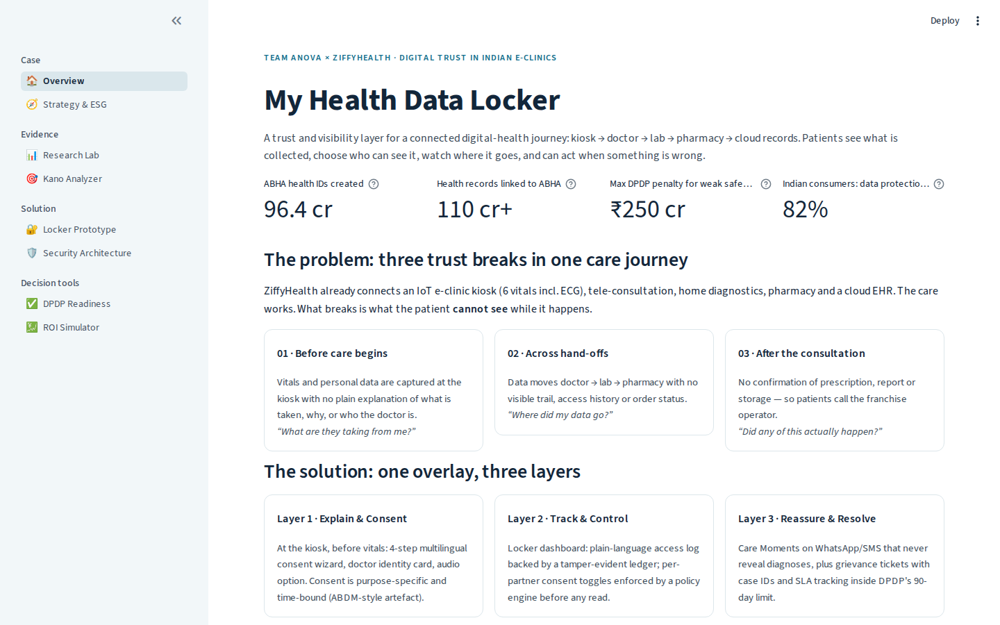
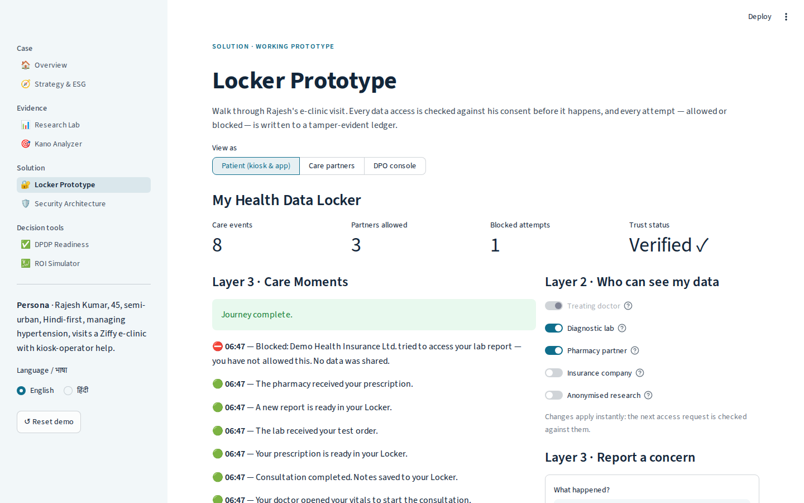
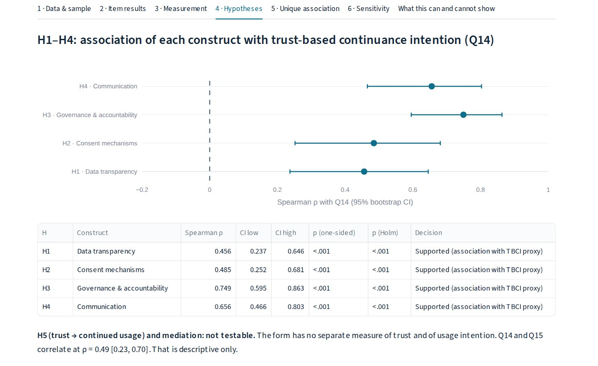
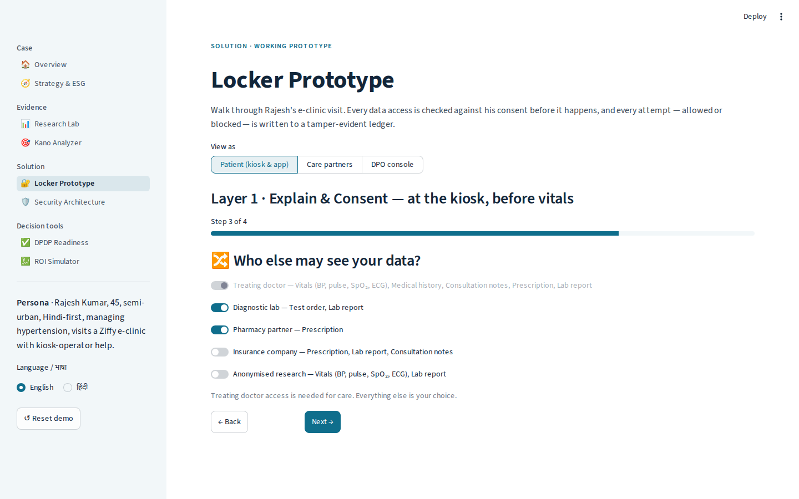
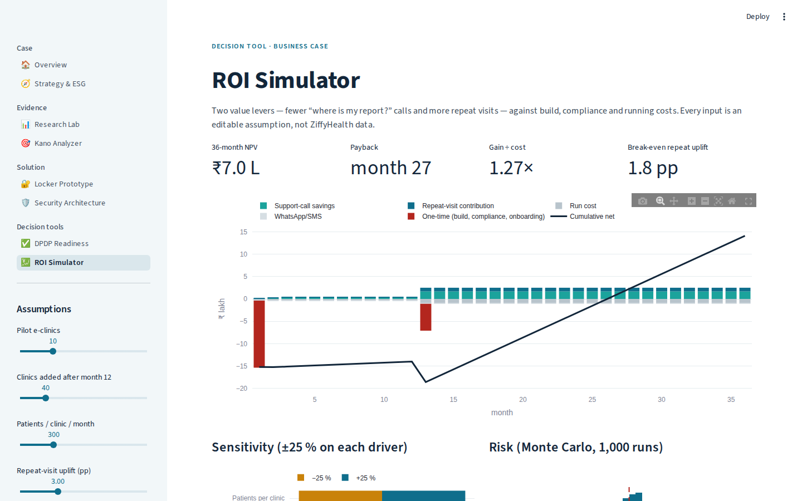

# 🔐 My Health Data Locker — Digital Trust Toolkit

**A trust and visibility layer for India's connected e-clinic journey, plus the research, security, compliance and business tooling behind it.**

Built from a WeSchool *Global Citizen Leadership* live project with **ZiffyHealth** (Pune) by **Team Anova**:
Anvesha Singh (Project Lead), Aastha Vithlani, Ajinkya Upasani, Raj Girase, Shriraam Sundar and Yukti Agarwal.
This repository is an independent, extended rebuild of the project for portfolio use.

> ⚠️ Concept prototype. Not affiliated with or endorsed by ZiffyHealth / Ziffytech Solutions Pvt Ltd.
> Research findings come only from the project's **genuine survey** (112 responses, de-identified). A synthetic dataset
> is included to demonstrate methods and is never used as evidence. Educational only: not legal or medical advice.
> What changed and why: [Correction log](docs/CORRECTION_LOG.md).



---

## The problem

ZiffyHealth connects an IoT e-clinic kiosk (6 vitals incl. ECG), tele-consultation, home diagnostics, pharmacy and a cloud EHR.
The care works, but the patient can't see what happens to their data along the way:

| Trust break | Patient's question |
|---|---|
| **Before care**: vitals captured with no plain explanation | *"What are they taking from me?"* |
| **Across hand-offs**: doctor → lab → pharmacy, no visible trail | *"Where did my data go?"* |
| **After care**: no confirmation of report or prescription | *"Did any of this actually happen?"* |

India's DPDP Rules (notified Nov 2025, most duties from **May 2027**) turn this into a regulatory deadline as well as a UX problem.

## The solution: three layers, one overlay

| Layer | Where | What it does |
|---|---|---|
| **1 · Explain & Consent** | Kiosk, before vitals | 4-step multilingual wizard, doctor identity card, purpose-bound consent that expires (like the ABDM consent artefact) |
| **2 · Track & Control** | Locker dashboard | Plain-language access log on a **hash-chained, tamper-evident ledger**. Per-partner toggles are **enforced by a policy engine before every read** |
| **3 · Reassure & Resolve** | WhatsApp/SMS + app | PHI-free "Care Moments" notifications and grievance tickets with case IDs and a response deadline (SLA) |

## What's in the app (8 pages)

| Page | Highlights |
|---|---|
| 🏠 Overview | Problem, solution, evidence notes |
| 📊 **Research Lab** | **Primary survey (genuine, n = 112):** sample flow, item results, two-item reliability, factor structure, HTMT, pre-specified hypothesis tests, robustness and sensitivity checks, and a page on what the data can and cannot show. Also: a generic pipeline for any Google-Forms export, and a synthetic method demo |
| 🎯 Kano Analyzer | Kano classifier (Better/Worse coefficients), shown on simulated responses. Illustrative until a real Kano survey is run |
| 🔐 **Locker Prototype** | Working journey in English/हिंदी, live consent enforcement, blocked-access demo, grievances, DPO console with **ledger verification, external anchoring and three tamper demos** |
| 🛡️ Security Architecture | Data-flow with trust boundaries, STRIDE threat model, CERT-In 6 h / DPB 72 h breach clock, PHI-safe notification checker |
| ✅ DPDP Readiness | 26 controls (DPDP Act/Rules, CERT-In, ABDM) → radar chart before and after the Locker, plus a prioritised gap list. Educational self-assessment, not certification |
| 💹 ROI Simulator | NPV, payback, tornado sensitivity, Monte Carlo. Every input is an assumption (no operating data); outputs are scenarios, not forecasts |
| 🧭 Strategy & ESG | PESTEL, Five Forces, strategic groups, ERRC, Keller CBBE, McKinsey 7S, RICE, Balanced Scorecard, ESG materiality (SASB, GRI 418, BRSR P9, SDG 3) |

| Locker: completed journey, blocked insurer | Research Lab: pre-specified hypothesis tests (genuine data) |
|---|---|
|  |  |
| **Consent wizard (step 3)** | **ROI simulator** |
|  |  |

## What the survey shows (genuine data)

Team Anova's Google Form, 13–17 January 2026: 112 responses, of which **74 had used a digital-healthcare platform**
and form the analytic sample. Plan: [`ANALYSIS_PLAN.md`](docs/primary/ANALYSIS_PLAN.md) (fixed before testing) ·
full output: [`RESULTS_PRIMARY.md`](docs/primary/RESULTS_PRIMARY.md) · reproduce: `python scripts/primary_analysis.py`.

- **Gaps.** Only 38% of users agree their platform has strong measures to protect their data (Q10) or would take
  responsibility if it were misused (Q11). 47% agree it is transparent about who can access their data (Q7).
- **Associations (H1–H4).** Favourable views of transparency (ρ = 0.46), consent (0.49), governance & accountability
  (0.75) and communication (0.66) are each associated with trust-based intention to keep using the platform
  (single item Q14; all Holm-adjusted p < .001).
- **Unique association.** With all four in one model (R² = 0.50), only **governance & accountability** keeps a clear
  unique association (standardised β = 0.50, 95% CI 0.14–0.84). This holds without straight-liners, without duplicate
  patterns and in an ordinal model.
- **What it cannot show.** The form has no separate trust measure, so trust → usage (H5) and mediation are **not
  testable**. The ten items share one dominant factor, so the four drivers are not empirically distinct. The sample is
  young, convenience-recruited and did not record location, language or kiosk use. Results are associations, not
  effects, and concern digital-health platforms in general, not ZiffyHealth.
- **Design implication (provisional).** Visible accountability (who is responsible, what happens on misuse, a
  tracked complaint) has the strongest support; the Locker's Layer 3 and access log address it. Pilot evidence is
  still needed: see [`FOLLOW_UP_RESEARCH.md`](docs/primary/FOLLOW_UP_RESEARCH.md).

**Business case.** Every ROI input is a planning assumption; no ZiffyHealth operating data was available. Under the
default assumptions a 10-clinic pilot alone does not repay the build, and call deflection is the most sensitive
driver, so the pilot has to measure it.

## Evidence status

| Material | Status |
|---|---|
| Primary survey results | Measured (genuine, n = 74 users) |
| Market and regulatory context | Published sources, cited |
| Frameworks (PESTEL, 7S, CBBE, RICE, ESG) | Team judgement |
| ROI, NPV, Monte Carlo | Simulation on assumptions |
| Kano categories, synthetic survey results | Simulated: method illustration only |
| Locker prototype | Implemented and tested in-app; simulated users and partners |

Registers: [Evidence](docs/EVIDENCE_REGISTER.md) · [Limitations](docs/LIMITATIONS_REGISTER.md) ·
[Data cards](docs/DATA_CARD.md) · [Corrections](docs/CORRECTION_LOG.md).
A 222-response file from a different project's survey was once associated with this project in error. It is
excluded entirely and is not in this repository.

## Run it

```bash
git clone https://github.com/anvesha2402/ziffy-trust-locker.git
cd ziffy-trust-locker
python -m venv .venv && source .venv/bin/activate   # Windows: .venv\Scripts\activate
pip install -r requirements.txt
streamlit run app.py
pytest -q                                          # unit, data-integrity and page tests
```

Deploy for free on Streamlit Community Cloud: see [docs/DEPLOY.md](docs/DEPLOY.md).

## Repository layout

```
app.py                  navigation (st.navigation, 8 pages)
app_pages/              one file per page (UI only)
core/
  primary.py            genuine survey: de-identification, coding, pre-specified analysis
  pipeline.py           generic export → cleaned → audited → modelled (any Google-Forms file)
  quality.py            data-quality audit + exclusion flow
  stats.py              α, correlations, OLS + VIF, bootstrap mediation, hypotheses
  locker.py             consent store, policy engine, hash-chained ledger, grievances, PHI checker
  dpdp.py               26-control readiness model
  roi.py                cash-flow, NPV, tornado, Monte Carlo
  kano.py               Kano classification + CS coefficients
  sample_data.py        synthetic demo survey + Kano generator (method illustration only)
data/primary/           de-identified genuine survey + follow-up instrument
data/                   synthetic demo datasets (file names end in _SYNTHETIC)
outputs/primary/        every published primary-survey number (CSV + results.json)
scripts/                primary_analysis.py (genuine data) · run_analysis.py (generic / synthetic)
docs/                   analysis plan, results, data cards, evidence / limitations registers, correction log
tests/                  unit + page smoke + click-through tests
```

## Sources

- ZiffyHealth: ziffytech.com (About, E-clinic pages); CB Insights company profile
- ABDM statistics: Digital Health News, 12 Aug 2026 · eSanjeevani: Digital Health News, 30 Jan 2026
- DPDP Rules 2025: PIB (17 Nov 2025); DLA Piper *Data Protection Laws of the World* (India); Rule 14(3) grievance period; MeitY transition proposal (Business Standard, 22 Jan 2026; not notified as of Oct 2026)
- CERT-In Directions (Apr 2022): 6-hour reporting, 180-day logs
- Market: IMARC India Digital Health (USD 19.1 bn 2025 → 90 bn 2034); Grand View Research India Telehealth
- PwC *Voice of the Consumer* 2024 (India): 82% cite data protection as the top trust factor
- Breaches: AIIMS Delhi (2022), ICMR-linked leak (2023), Star Health (2024, TechRadar)
- Kano et al. (1984); Berger et al. (1993); Keller (1993) CBBE; Eisinga et al. (2013) two-item reliability; Henseler et al. (2015) HTMT; Horn (1965) parallel analysis; Holm (1979); Long & Ervin (2000) HC3

MIT licence · © 2026 Anvesha Singh & Team Anova
