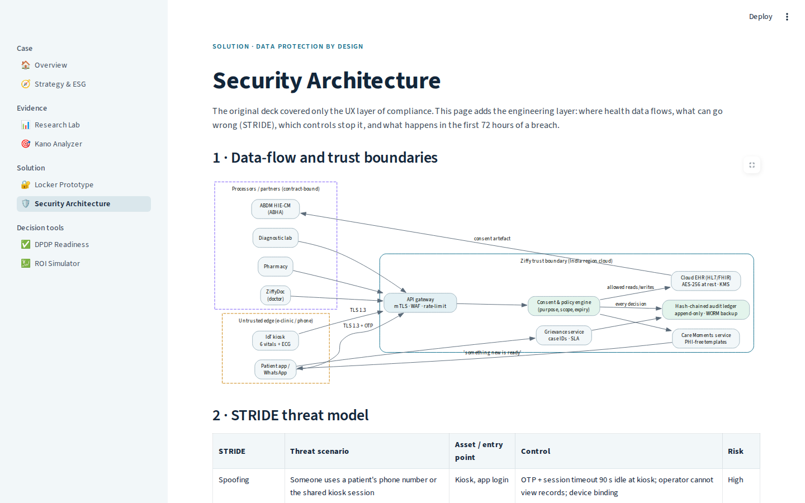
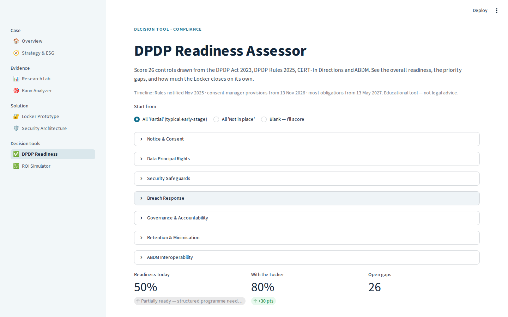
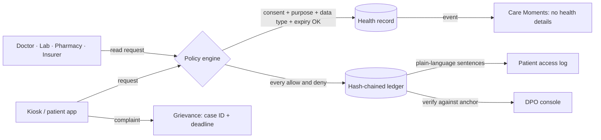

<div align="center">

# 🔐 My Health Data Locker

### A digital-trust toolkit for India's connected e-clinic journey

Research, a working prototype, security and compliance tooling, and a business case,
built from a live project with **ZiffyHealth** (Pune).

[](https://ziffy-trust-locker-dwgjpkayxh5jiupr7fmvso.streamlit.app)


**[Live app](https://ziffy-trust-locker-dwgjpkayxh5jiupr7fmvso.streamlit.app)** ·
[Research Lab](https://ziffy-trust-locker-dwgjpkayxh5jiupr7fmvso.streamlit.app/research_lab) ·
[Locker prototype](https://ziffy-trust-locker-dwgjpkayxh5jiupr7fmvso.streamlit.app/locker) ·
[Strategy & ESG](https://ziffy-trust-locker-dwgjpkayxh5jiupr7fmvso.streamlit.app/strategy) ·
[ROI simulator](https://ziffy-trust-locker-dwgjpkayxh5jiupr7fmvso.streamlit.app/roi)


</div>

---

## At a glance

| | |
|---|---|
| **Client** | ZiffyHealth (Ziffytech Solutions Pvt Ltd), Pune: IoT e-clinic kiosk, tele-consultation, home diagnostics, pharmacy and a cloud health record |
| **Team** | Team Anova, WeSchool PGDM 2025–27 (*Global Citizen Leadership* live project): Anvesha Singh (Project Lead), Aastha Vithlani, Ajinkya Upasani, Raj Girase, Shriraam Sundar, Yukti Agarwal |
| **Problem** | Patients cannot see what happens to their health data as it moves from kiosk to doctor to lab to pharmacy |
| **Solution** | A three-layer trust overlay on existing systems: explain and consent, track and control, reassure and resolve |
| **Evidence** | 112 survey responses (74 platform users), analysed under a plan fixed before testing |
| **Built** | An 8-page Streamlit app with a working consent policy engine, a hash-chained audit ledger and 31 automated tests |

> ⚠️ Independent portfolio rebuild of a student live project. Not affiliated with or endorsed by ZiffyHealth.
> Educational only: not legal or medical advice. What changed and why: [Correction log](docs/CORRECTION_LOG.md).

---

## Contents

1. [The problem](#-the-problem)
2. [What the survey shows](#-what-the-survey-shows)
3. [The solution](#-the-solution)
4. [What's in the app](#-whats-in-the-app)
5. [How the Locker works](#-how-the-locker-works)
6. [Business case](#-business-case)
7. [Evidence status](#-evidence-status)
8. [Run it locally](#-run-it-locally)
9. [Repository layout](#-repository-layout)
10. [Sources](#-sources)

---

## 🩺 The problem

ZiffyHealth's care works. What breaks is what the patient **cannot see** while it happens.

| Trust break | Where | The patient's question |
|---|---|---|
| **Before care** | Vitals captured at the kiosk with no plain explanation | *"What are they taking from me?"* |
| **Across hand-offs** | Data moves doctor → lab → pharmacy with no visible trail | *"Where did my data go?"* |
| **After care** | No confirmation of report, prescription or record | *"Did any of this actually happen?"* |

**Why now:** India's DPDP Rules were notified in November 2025. Most duties apply from **13 May 2027**, with penalties
of up to **₹250 crore** for inadequate security safeguards.

---

## 📊 What the survey shows

Team Anova's Google Form, 13–17 January 2026: **112 responses**, of which **74 had used a digital-health platform**.

| Finding | Result |
|---|---|
| **Gaps in current practice** | Only **38%** agree their platform protects their data from misuse; **38%** that it would take responsibility if data were misused; **47%** that it is transparent about who can access their data |
| **H1–H4 (associations)** | Favourable views of transparency (ρ = 0.46), consent (0.49), governance & accountability (0.75) and communication (0.66) each go with higher trust-based intention to keep using a platform (all Holm-adjusted p < .001) |
| **Strongest unique link** | With all four in one model (R² = 0.50), only **governance & accountability** keeps a clear association (β = 0.50, 95% CI 0.14–0.84); robust to removing suspect responses and to an ordinal model |
| **Not testable** | Trust → continued use (H5) and mediation: the form had no separate trust or intention measure |

<details>
<summary><b>What these results can and cannot show</b></summary>

- **Associations, not effects.** One-time, self-reported survey; no causal claim.
- **Proxy outcome.** Q14 ("Because I trust the platform, I intend to continue using it") mixes trust and intention.
- **Constructs overlap.** One factor explains 54% of the answers; governance and communication are not distinguishable (HTMT 1.07).
- **Sample.** Convenience sample, mostly aged 18–35; location, language and kiosk use were not asked. Results describe digital-health platforms in general, not ZiffyHealth or its e-clinic patients.
- **Next step.** A follow-up instrument with direct trust and intention scales is in [`docs/primary/FOLLOW_UP_RESEARCH.md`](docs/primary/FOLLOW_UP_RESEARCH.md).

Plan: [`ANALYSIS_PLAN.md`](docs/primary/ANALYSIS_PLAN.md) · Full output: [`RESULTS_PRIMARY.md`](docs/primary/RESULTS_PRIMARY.md) · Reproduce: `python scripts/primary_analysis.py`
</details>

<p align="center"></p>

---

## 💡 The solution

**My Health Data Locker** is an overlay, not a new platform. Every screen reads from an event ZiffyHealth already produces.

| Layer | Delivered at | What it does | Patient outcome |
|---|---|---|---|
| **1 · Explain & Consent** | Kiosk, before vitals | 4-step multilingual consent wizard, doctor identity card, purpose-bound consent that expires (ABDM-style) | *"I know what's happening. I chose to agree."* |
| **2 · Track & Control** | Locker dashboard | Plain-language access log on a tamper-evident ledger; per-partner switches enforced **before** every read | *"I can see where my data went."* |
| **3 · Reassure & Resolve** | WhatsApp / SMS / app | Status messages that never reveal health details; complaints with a case ID and a deadline | *"If something's wrong, I can act."* |

The survey points the design toward **visible accountability first**: a named owner, a tracked complaint and an access log.

---

## 🧰 What's in the app

| Page | What you can do |
|---|---|
| 🏠 [**Overview**](https://ziffy-trust-locker-dwgjpkayxh5jiupr7fmvso.streamlit.app) | Problem, solution and what is measured vs assumed |
| 📊 [**Research Lab**](https://ziffy-trust-locker-dwgjpkayxh5jiupr7fmvso.streamlit.app/research_lab) | Genuine survey analysis: sample, item results, reliability, factor structure, HTMT, hypothesis tests, robustness. Also analyses any Google-Forms export you upload |
| 🎯 [**Kano Analyzer**](https://ziffy-trust-locker-dwgjpkayxh5jiupr7fmvso.streamlit.app/kano) | Kano classification tool, ready for a real feature survey (shown on simulated data) |
| 🔐 [**Locker Prototype**](https://ziffy-trust-locker-dwgjpkayxh5jiupr7fmvso.streamlit.app/locker) | Walk through a patient visit in English or हिंदी; try partner requests that get blocked; tamper with the audit log as an insider and watch it get caught |
| 🛡️ [**Security Architecture**](https://ziffy-trust-locker-dwgjpkayxh5jiupr7fmvso.streamlit.app/security) | Data flow and trust boundaries, STRIDE threat model, breach clock (CERT-In 6 h, DPB 72 h), notification checker |
| ✅ [**DPDP Readiness**](https://ziffy-trust-locker-dwgjpkayxh5jiupr7fmvso.streamlit.app/dpdp) | Score 26 controls from the DPDP Act and Rules, CERT-In and ABDM; see which gaps the Locker closes |
| 💹 [**ROI Simulator**](https://ziffy-trust-locker-dwgjpkayxh5jiupr7fmvso.streamlit.app/roi) | Change every assumption; see NPV, payback, sensitivity and a Monte Carlo spread |
| 🧭 [**Strategy & ESG**](https://ziffy-trust-locker-dwgjpkayxh5jiupr7fmvso.streamlit.app/strategy) | PESTEL, Five Forces, ERRC, CBBE, McKinsey 7S, RICE, Balanced Scorecard, ESG materiality |

<table>
<tr>
<td width="50%"><br><sub><b>Layer 1</b>: consent wizard, step 3</sub></td>
<td width="50%"><br><sub><b>Layers 2–3</b>: completed visit; insurer request blocked</sub></td>
</tr>
<tr>
<td width="50%"><br><sub><b>Security</b>: data flow and trust boundaries</sub></td>
<td width="50%"><br><sub><b>Compliance</b>: DPDP readiness before and with the Locker</sub></td>
</tr>
</table>

---

## ⚙️ How the Locker works



- **Policy engine:** a partner gets data only if consent is granted, the declared purpose matches, the data type is in scope and consent has not expired.
- **Audit ledger:** each entry stores the SHA-256 hash of the previous one, so editing any past entry breaks the chain. An external anchor (entry count and latest hash kept outside the database) also catches deleted or rewritten entries. No log can prove that an unlogged access never happened, so production would enforce the checks at the API gateway.
- **Scope:** the prototype runs on a simulated patient, simulated partners and simulated events. It is not connected to ZiffyHealth systems.

---

## 💹 Business case

Two levers: fewer *"where is my report?"* calls, and more repeat visits. **Every input is a planning assumption**
(no ZiffyHealth operating data was available), so these are scenarios, not forecasts.

| Scenario (36 months, 14% discount rate) | NPV | Payback |
|---|---|---|
| Pilot only, 10 clinics | −₹11.6 lakh | Not within 36 months |
| Pilot + 40 clinics from month 13 | ₹7.0 lakh | Month 27 |

Call deflection is the most sensitive assumption. The pilot is therefore designed as a measurement exercise:
scale only if, against matched control clinics, call deflection reaches **28%** and repeat visits rise by **1.8 percentage points**.

<p align="center"></p>

---

## 🧾 Evidence status

| Material | Status |
|---|---|
| Survey results | **Measured**: genuine responses, n = 74 users |
| Market and regulatory context | **Published sources**, cited below |
| Frameworks (PESTEL, 7S, CBBE, RICE, ESG) | **Team judgement** |
| ROI, NPV, Monte Carlo | **Simulation** on stated assumptions |
| Kano categories, synthetic survey demo | **Simulated**: method illustration only |
| Locker prototype | **Implemented and tested** in-app, with simulated users and partners |

Registers: [Evidence](docs/EVIDENCE_REGISTER.md) · [Limitations](docs/LIMITATIONS_REGISTER.md) ·
[Data cards](docs/DATA_CARD.md) · [Corrections](docs/CORRECTION_LOG.md)

---

## 🚀 Run it locally

```bash
git clone https://github.com/anvesha2402/ziffy-trust-locker.git
cd ziffy-trust-locker
python -m venv .venv && source .venv/bin/activate   # Windows: .venv\Scripts\activate
pip install -r requirements.txt
streamlit run app.py
pytest -q                                           # 31 tests
```

Free deployment on Streamlit Community Cloud: see [docs/DEPLOY.md](docs/DEPLOY.md).

---

## 🗂️ Repository layout

<details>
<summary>Show the folder structure</summary>

```
app.py                  navigation (8 pages)
app_pages/              one file per page (UI only)
core/
  primary.py            genuine survey: de-identification, coding, pre-specified analysis
  locker.py             consent store, policy engine, hash-chained ledger, grievances, PHI checker
  dpdp.py               26-control readiness model
  roi.py                cash flow, NPV, tornado, Monte Carlo
  kano.py               Kano classification
  pipeline.py           generic Google-Forms export → cleaned → audited → modelled
  quality.py, stats.py  data-quality audit and statistics for the generic pipeline
  sample_data.py        synthetic demo data generator (method illustration only)
data/primary/           de-identified genuine survey + follow-up instrument
data/                   synthetic demo datasets (file names end in _SYNTHETIC)
outputs/primary/        every published survey number (CSV + results.json)
scripts/                primary_analysis.py (genuine data) · run_analysis.py (generic)
docs/                   analysis plan, results, data cards, registers, correction log, follow-up research
tests/                  unit, data-integrity, page and click-through tests
```
</details>

---

## 📚 Sources

<details>
<summary>Show sources</summary>

- ZiffyHealth: ziffytech.com (About, E-clinic pages); CB Insights company profile
- ABDM statistics: Digital Health News, 12 Aug 2026 · eSanjeevani: Digital Health News, 30 Jan 2026
- DPDP Rules 2025: PIB (17 Nov 2025); DLA Piper *Data Protection Laws of the World* (India); Rule 14(3) grievance period; MeitY transition proposal (Business Standard, 22 Jan 2026; not notified as of Oct 2026)
- CERT-In Directions (Apr 2022): 6-hour reporting, 180-day logs
- Market: IMARC India Digital Health (USD 19.1 bn 2025 → 90 bn 2034); Grand View Research India Telehealth
- PwC *Voice of the Consumer* 2024 (India): 82% cite data protection as the top trust factor
- Breaches: AIIMS Delhi (2022), ICMR-linked leak (2023), Star Health (2024, TechRadar)
- Methods: Eisinga et al. (2013) two-item reliability; Horn (1965) parallel analysis; Henseler et al. (2015) HTMT; Holm (1979); Long & Ervin (2000) HC3; Kano et al. (1984); Berger et al. (1993); Keller (1993) CBBE; Venkatesh et al. (2003) UTAUT
</details>

---

<div align="center">
<sub>MIT licence · © 2026 Anvesha Singh & Team Anova · Built with Python, Streamlit, SQLite and Plotly</sub>
</div>
